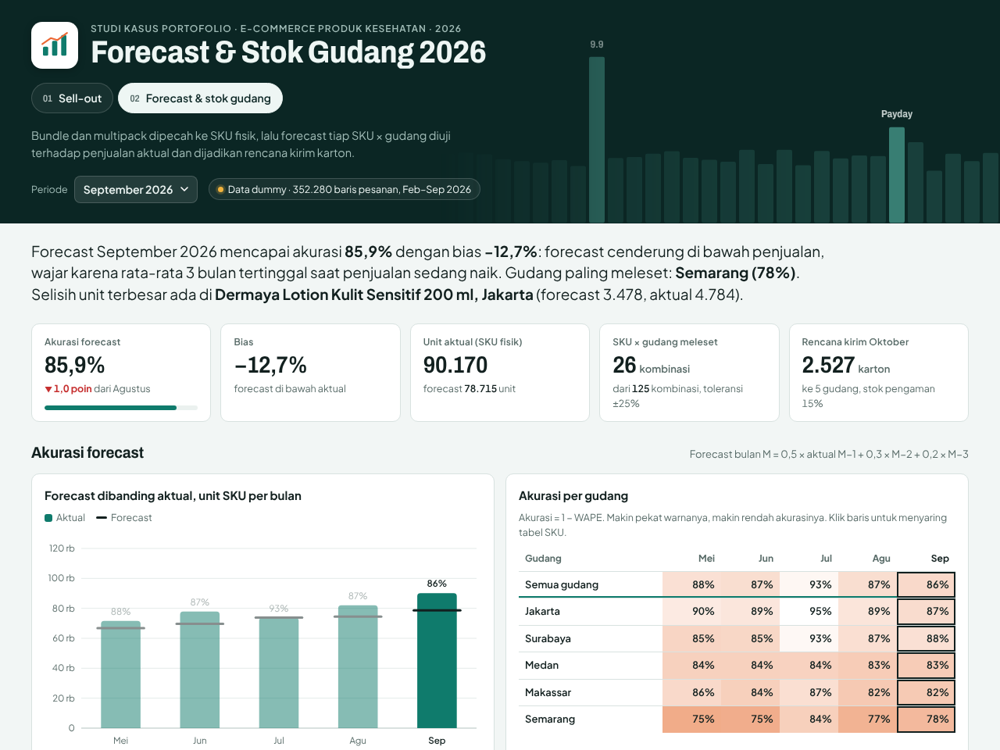
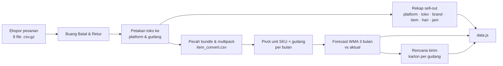

# E-commerce Analytics Dashboard 2026

**Demo:** https://andinasywan.github.io/ecommerce-analytics-dashboard/


> **Semua data di repo ini dummy.** Nama brand, SKU, toko, nomor pesanan, dan angka dibuat oleh generator acak
> (`tools/generate_dummy_data.py`). Tidak ada data internal perusahaan yang dipakai.

*English summary: a two-page dashboard for a (fictional) consumer-health brand selling on Indonesian marketplaces.
Page 1 tracks sell-out by platform, store, brand and item. Page 2 explodes bundles into physical SKUs, tests a
3-month weighted moving-average forecast per SKU × warehouse against actual sales, and turns next month's forecast
into a carton shipment plan. Built with plain HTML/CSS/JS (no chart library) and a Python/pandas pipeline. All data is synthetic.*

## Latar belakang

Selama magang sebagai Data Analyst Intern di Soho Global Health, saya mengolah ekspor pesanan marketplace menjadi
laporan sell-out bulanan dan file kebutuhan stok per gudang. Prosesnya di Excel: menggabungkan ratusan ribu baris
pesanan, memetakan setiap toko ke gudang pengirimnya, memecah produk bundle ke SKU komponen lewat tabel *master convert*,
lalu membuat pivot per SKU dan gudang.

Repo ini menulis ulang alur itu di Python dan menampilkannya sebagai dasbor, dengan data dummy yang meniru bentuk
dan pola data aslinya (lonjakan tanggal kembar, payday, flash sale tengah malam, bundle, multi-gudang).

## Isi dasbor

**01 · Sell-out**
- KPI bulanan: GMV, pesanan, unit, nilai rata-rata pesanan, porsi GMV hari kampanye
- GMV per platform per bulan dan GMV harian dengan hari kampanye (9.9, payday)
- Porsi platform, jam belanja, tabel 19 toko dengan gudangnya
- Brand: kontribusi dibanding pertumbuhan (klik untuk menyaring item), lalu rincian item yang bisa dicari

**02 · Forecast & stok gudang**
- Akurasi forecast (1 − WAPE) dan bias per bulan dan per gudang
- Sebaran forecast vs aktual per SKU × gudang, profil SKU dengan catatan otomatis (lonjakan, stok kosong, tren)
- Peta panas selisih forecast untuk 25 SKU × 5 gudang
- Rencana kirim bulan depan dalam karton per gudang
- Alur pengolahan data dengan angka tiap langkah



## Alur data



## Metode forecast

```
Forecast(M) = 0,5 × Aktual(M−1) + 0,3 × Aktual(M−2) + 0,2 × Aktual(M−3)
Akurasi     = 1 − Σ|forecast − aktual| ÷ Σ aktual        (WAPE)
Bias        = (Σ forecast − Σ aktual) ÷ Σ aktual
Karton      = ⌈forecast × 1,15 ÷ isi per karton⌉          (stok pengaman 15%)
```

Februari–April hanya dipakai sebagai riwayat awal. Forecast diuji untuk Mei–September, lalu forecast Oktober
dijadikan rencana kirim.

Data dummy sengaja diberi beberapa kejadian supaya kelemahan rata-rata bergerak terlihat:
produk yang viral di TikTok pada Agustus, stok kosong di satu gudang pada Juli, program affiliate pada September,
dan produk musiman (sirup batuk) yang naik saat musim hujan.

## Struktur repo

```
index.html, style.css, js/        dasbor (HTML/CSS/JS murni, grafik SVG buatan sendiri)
data.js                           data agregat untuk dasbor (hasil pipeline)
tools/generate_dummy_data.py      generator data dummy
tools/build_dashboard_data.py     pipeline: raw -> data.js + CSV olahan
data/raw/orders_2026-MM.csv.gz    ekspor pesanan dummy per bulan (Feb–Sep 2026)
data/master/                      sku_master, item_convert (bundle -> SKU), store_map (toko -> gudang)
data/processed/                   unit SKU × gudang per bulan, forecast vs aktual, rencana kirim
```

### Kolom ekspor pesanan (`data/raw`)

| Kolom | Isi |
|---|---|
| `order_id` | nomor pesanan, formatnya beda per platform |
| `order_datetime`, `order_date` | waktu pesanan (WIB) |
| `store` | nama toko, dipetakan ke platform & gudang lewat `store_map.csv` |
| `item_code`, `item_name` | item jual: SKU tunggal, multipack, atau bundle |
| `brand`, `category` | brand dan kategori (Anak & Keluarga / Dewasa & Spesialis) |
| `qty`, `gmv` | jumlah item dan nilai transaksi (Rp) |
| `status` | Selesai, Dalam pengiriman, Batal, Retur |

## Menjalankan ulang

```bash
pip install -r requirements.txt
python tools/generate_dummy_data.py     # opsional: buat ulang data dummy (seed tetap)
python tools/build_dashboard_data.py    # bangun data.js dan data/processed/
python -m http.server 8000              # buka http://localhost:8000
```

## Publikasi ke GitHub Pages

Settings → Pages → *Deploy from a branch* → `main` / `(root)`. Tidak ada build step; file `.nojekyll` sudah disertakan.

## Teknologi

Python (pandas, numpy) untuk data · HTML, CSS, JavaScript murni untuk dasbor · grafik SVG digambar sendiri, tanpa library grafik ·
font Archivo dan Plus Jakarta Sans.
