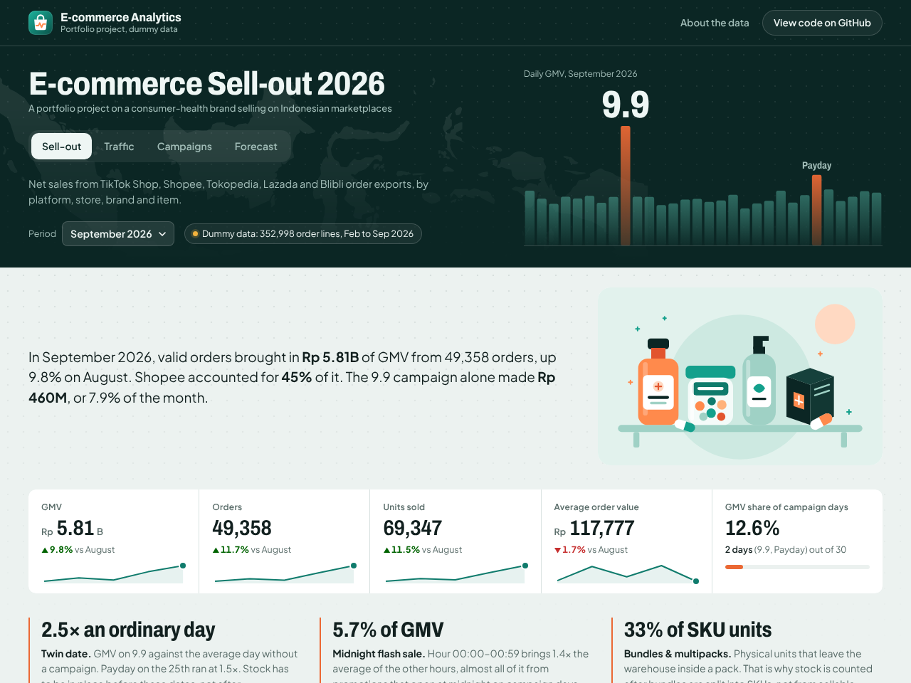
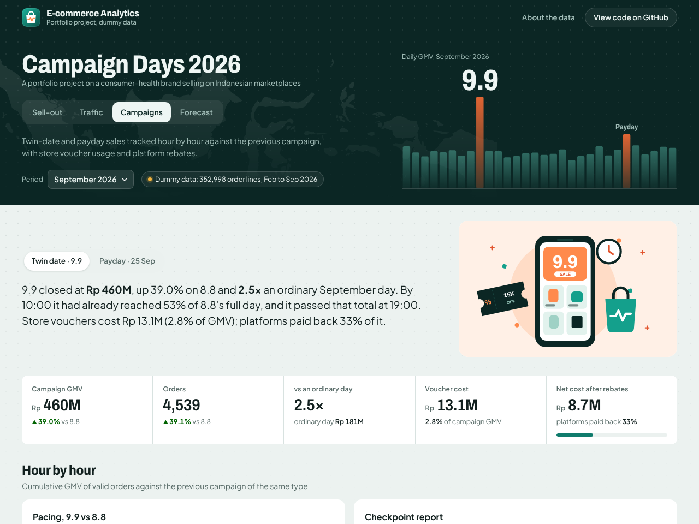
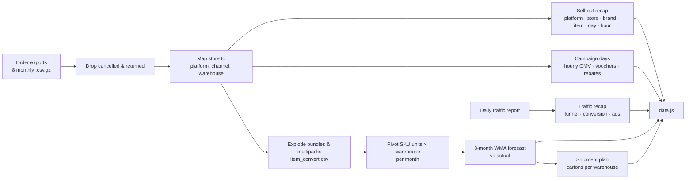

# E-commerce Analytics Dashboard 2026

**Live demo:** https://andinasywan.github.io/ecommerce-analytics-dashboard/



> **All data in this repository is dummy data.** Brand names, SKUs, stores, order numbers, voucher codes and
> every figure are produced by a random generator (`tools/generate_dummy_data.py`). No company data is included.

A four-page dashboard for a fictional consumer-health brand that sells on Indonesian marketplaces
(TikTok Shop, Shopee, Tokopedia, Lazada, Blibli) and ships from five warehouses.

## Background

During my Data Analyst internship at Soho Global Health I turned raw marketplace exports into recurring reports:
monthly sell-out, warehouse stock needs, hour-by-hour updates on twin-date and payday campaigns, voucher usage,
platform rebates and store traffic. The work ran in Excel: combining hundreds of thousands of order lines, mapping
each store to its shipping warehouse, splitting bundles into component SKUs with a *master convert* table, and
building pivots.

This repository rebuilds that workflow in Python and presents it as a dashboard. The dummy data copies the shape
and the seasonality of the real exports (twin-date spikes, payday, midnight flash sales, bundles, multiple
warehouses, vouchers that sell out), never the real names or numbers.

## Pages

**01 · Sell-out**
- Monthly KPIs: GMV, orders, units, average order value, GMV share of campaign days
- Map of Indonesia with two views: buyers by province (with the share of orders shipped from the nearest warehouse
  and the biggest detours), and the five warehouses sized by GMV shipped (click one to filter the store table)
- GMV by platform per month and daily GMV with campaign days marked
- Platform share, shopping hours, and a table of 19 stores with their warehouse
- Brands: contribution vs growth (click to filter items), then a searchable item table

**02 · Traffic**
- Visitors, platform-reported orders, conversion rate, ad click-through rate, visits from ads
- Store funnel (visitors → product clicks → orders) and the ads funnel
- Conversion by platform per month, daily visitors and conversion
- TikTok Shop GMV by content source (LIVE, video, product card)
- Store table with conversion, ad CTR and visitor growth

**03 · Campaign days**
- Twin date (e.g. 9.9) or payday (25th) of the chosen month
- Hour-by-hour cumulative GMV against the previous campaign of the same type
- Checkpoint report at 02:00, 10:00, 14:00, 18:00 and full day, per channel
- Campaign history since February against the ordinary-day average
- Store vouchers: quota, usage, sell-out time, cost and GMV per Rp1 of voucher cost
- Voucher cost after platform rebates

**04 · Forecast & stock**
- Warehouse network map: next month's cartons per warehouse, ringed by forecast accuracy
- Forecast accuracy (1 − WAPE) and bias by month and warehouse
- Forecast vs actual per SKU × warehouse, SKU profile with automatic notes (spikes, stock-outs, trend)
- Heat map of forecast error for 25 SKUs × 5 warehouses
- Next month's shipment plan in cartons per warehouse
- The processing pipeline with the numbers at each step



## Data flow



## Forecast method

```
Forecast(M) = 0.5 × Actual(M−1) + 0.3 × Actual(M−2) + 0.2 × Actual(M−3)
Accuracy    = 1 − Σ|forecast − actual| ÷ Σ actual        (WAPE)
Bias        = (Σ forecast − Σ actual) ÷ Σ actual
Cartons     = ⌈forecast × 1.15 ÷ units per carton⌉       (15% safety stock)
```

February–April only seed the history. Forecasts are tested for May–September, and the October forecast becomes
the shipment plan. The dummy data includes a few events that expose the weak spots of a moving average:
a product that goes viral on TikTok in August, a stock-out in one warehouse in July, an affiliate push in
September, and a seasonal cough syrup that picks up when the rainy season starts.

## Repository layout

```
index.html, style.css, js/        the dashboard (plain HTML/CSS/JS, hand-drawn SVG charts)
data.js                           aggregated data for the dashboard (pipeline output)
tools/generate_dummy_data.py      dummy data generator
tools/build_dashboard_data.py     pipeline: raw exports -> data.js + processed CSVs
tools/build_map.py                map outlines and province centroids -> js/geo.js, data/master/provinces.csv (Natural Earth, public domain)
data/raw/orders_2026-MM.csv.gz    monthly order exports (Feb–Sep 2026)
data/raw/traffic_daily.csv.gz     daily traffic report per store
data/raw/platform_rebates.csv     platform rebates on campaign days
data/master/                      sku_master, item_convert (bundle -> SKU), store_map, vouchers
data/processed/                   SKU × warehouse units, forecast vs actual, shipment plan
```

### Order export columns (`data/raw/orders_*.csv.gz`)

| Column | Meaning |
|---|---|
| `order_id` | order number, format differs per platform |
| `order_datetime`, `order_date` | time of order (WIB) |
| `store` | store name, mapped to platform, channel and warehouse in `store_map.csv` |
| `item_code`, `item_name` | sellable item: single SKU, multipack or bundle |
| `brand`, `category` | brand and category (Kids & Family / Adult & Specialty) |
| `qty`, `gmv` | quantity and merchandise value (Rp) |
| `status` | Completed, In transit, Cancelled, Returned |
| `tiktok_channel` | TikTok Shop content source: LIVE, Video, Product card |
| `voucher_code`, `voucher_discount` | store voucher redeemed on the order and its cost to the seller |
| `buyer_province` | province of the buyer (dummy); `data/master/provinces.csv` holds each province's nearest warehouse and distances |

### Traffic report columns (`data/raw/traffic_daily.csv.gz`)

`date`, `store`, `organic_views`, `product_clicks`, `visitors`, `orders`, `ad_impressions`, `ad_clicks`

## Run it yourself

```bash
pip install -r requirements.txt
python tools/generate_dummy_data.py     # optional: regenerate the dummy data (fixed seed)
python tools/build_dashboard_data.py    # build data.js and data/processed/
python tools/build_map.py               # optional: rebuild the map outlines in js/geo.js
python -m http.server 8000              # open http://localhost:8000
```

## Publishing on GitHub Pages

Settings → Pages → *Deploy from a branch* → `main` / `(root)`. There is no build step; `.nojekyll` is included.

## Built with

Python (pandas, numpy) for the data · plain HTML, CSS and JavaScript for the dashboard · SVG charts drawn by hand,
no chart library · map outlines from Natural Earth · flat illustrations drawn for this project (assets/illustrations) · Archivo and Plus Jakarta Sans fonts.
